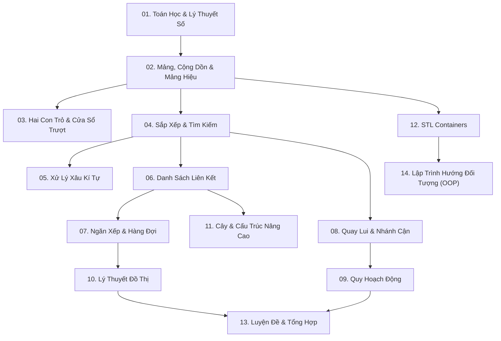

# Kho Lưu Trữ & Giáo Trình Giải Thuật Cấu Trúc Dữ Liệu & Giải Thuật (DSA) C++

Chào mừng bạn đến với kho lưu trữ tổng hợp các giải thuật và cấu trúc dữ liệu được tổ chức theo cấu trúc chuẩn **Per-Problem Directory** (mỗi bài toán là một thư mục riêng biệt).

## 1. Cấu trúc tổng quan
- Toàn bộ dự án gồm **226** tệp mã nguồn và tài nguyên được chia thành **14** chuyên mục lớn.
- Tổng cộng gồm **214** thư mục bài toán chuyên biệt.
- Trong mỗi thư mục bài toán:
  - Tệp mã nguồn C++ gốc (`.cpp`, `.c++`, `.h`) được giữ nguyên vẹn 100%.
  - Tệp `README.md` giải thích chi tiết phương án giải, các bước thực hiện, sơ đồ Mermaid trực quan hóa luồng thuật toán, phân tích độ phức tạp và bộ test case Input/Output mẫu.

---

## 2. Bảng Danh Mục Các Chuyên Đề DSA

| Chuyên đề | Số lượng bài | Số lượng file | Mô tả nội dung trọng tâm |
| :--- | :---: | :---: | :--- |
| [01. Toán Học & Lý Thuyết Số (Number Theory & Math)](./01_Toan_Hoc_va_Ly_Thuyet_So/) | **32** | 32 | Các giải thuật lý thuyết số và toán học cơ bản: Số nguyên tố, Sàng Eratosthenes, Phân tích thừa số nguyên tố, Phi hàm Euler, Lũy thừa nhị phân, Giai thừa, Số hoàn hảo, Số thuận nghịch, Số đẹp, và các phép tính hình học/số học cơ bản. |
| [02. Mảng, Mảng Cộng Dồn & Mảng Hiệu (Arrays & Prefix Sums)](./02_Mang_va_Mang_Cong_Don/) | **28** | 28 | Kỹ thuật xử lý mảng 1 chiều, mảng 2 chiều và ma trận; Mảng cộng dồn 1D & 2D để tối ưu hóa truy vấn tổng đoạn O(1); Mảng hiệu (Difference Array) cập nhật đoạn O(1); Kỹ thuật loang trên ma trận (Flood Fill) và các thao tác mảng thường gặp. |
| [03. Hai Con Trỏ & Cửa Sổ Trượt (Two Pointers & Sliding Window)](./03_Hai_Con_Tro_va_Cua_So_Truot/) | **4** | 4 | Kỹ thuật hai con trỏ (Two Pointers) và cửa sổ trượt (Sliding Window) có kích thước cố định hoặc biến đổi; Tối ưu hóa kiểm tra phần tử trùng lặp trong cửa sổ, tìm phần tử lớn nhất/nhỏ nhất trong cửa sổ kích thước K sử dụng Deque. |
| [04. Sắp Xếp & Tìm Kiếm (Sorting & Searching)](./04_Sap_Xep_va_Tim_Kiem/) | **18** | 18 | Các giải thuật sắp xếp từ cơ bản (Selection, Insertion, Bubble, Interchange) đến nâng cao (Quick Sort phân hoạch Lomuto/Hoare, Merge Sort); Tìm kiếm nhị phân (Binary Search), lower_bound, upper_bound; Sắp xếp tùy biến theo cặp (Pair), số nguyên tố, chẵn lẻ. |
| [05. Xử Lý Xâu Kí Tự (String Manipulation)](./05_Xau_Ki_Tu/) | **20** | 20 | Các kỹ thuật xử lý chuỗi ký tự trong C++: Chuẩn hóa họ tên, sinh email, đảo ngược chuỗi/tên, tách từ bằng stringstream, xóa từ khỏi câu, kiểm tra xâu Pangram, xâu đối xứng (Palindrome), xâu đẳng cấu (Isomorphic), tìm kiếm mẫu chuỗi con. |
| [06. Danh Sách Liên Kết (Linked Lists)](./06_Danh_Sach_Lien_Ket/) | **14** | 14 | Cấu trúc tự trỏ (Self-referential Structure), cài đặt danh sách liên kết đơn (Singly Linked List) và đôi (Doubly Linked List); Các thao tác thêm, xóa (đầu, cuối, vị trí K), duyệt, sắp xếp node; Cài đặt Stack bằng DSLK; Các bài toán LeetCode kinh điển về DSLK. |
| [07. Ngăn Xếp & Hàng Đợi (Stack, Queue, Deque, Priority Queue)](./07_Ngan_Xep_va_Hang_Doi/) | **10** | 10 | Cài đặt và ứng dụng Ngăn xếp (Stack - LIFO) để kiểm tra tính hợp lệ của dấu ngoặc, biểu thức số học; Hàng đợi (Queue - FIFO); Hàng đợi hai đầu (Deque); Hàng đợi nhị phân; Hàng đợi ưu tiên (Priority Queue / Min-Heap) giải bài toán nối dây tham lam (Huffman). |
| [08. Quay Lui & Nhánh Cận (Backtracking & Recursion)](./08_Quay_Lui_va_Nhanh_Can/) | **6** | 6 | Kỹ thuật duyệt toàn bộ không gian trạng thái: Thuật toán sinh kế tiếp, đệ quy quay lui (Backtracking) sinh xâu nhị phân, sinh tổ hợp chập K của N, sinh hoán vị N phần tử, hoán vị dùng con trỏ và bài toán Tổng kết hợp (Combination Sum). |
| [09. Quy Hoạch Động (Dynamic Programming)](./09_Quy_Hoach_Dong/) | **8** | 8 | Các bài toán Quy hoạch động (Dynamic Programming - DP) kinh điển: Dãy con tăng dài nhất (LIS), Xâu con chung dài nhất (LCS), Xâu con đối xứng dài nhất (LPS), Dãy con có tổng lớn nhất (Kadane Algorithm), Leo cầu thang, Bước nhảy tối thiểu (Jump Game), Mua bán cổ phiếu, Đường đi lớn nhất trên ma trận. |
| [10. Lý Thuyết Đồ Thị (Graph Theory)](./10_Do_Thi/) | **31** | 33 | Hệ thống bài toán đồ thị toàn diện: Biểu diễn đồ thị (Ma trận kề, Danh sách cạnh, Danh sách kề) và chuyển đổi qua lại; Thuật toán tìm kiếm BFS và DFS; Tìm đường đi trên đồ thị không trọng số; Thuật toán Dijkstra tìm đường đi ngắn nhất có trọng số; Đếm thành phần liên thông (đồ thị và lưới ma trận); Kiểm tra chu trình; Sắp xếp Tô-pô (DFS và thuật toán Kahn); Đồ thị hai phía (Bipartite); Đỉnh trụ và Cạnh cầu; Thành phần liên thông mạnh (SCC); Chu trình Euler; Cấu trúc tập hợp rời rạc (DSU). |
| [11. Cây & Cấu Trúc Dữ Liệu Nâng Cao (Trees & Advanced Data Structures)](./11_Cay_va_Cau_Truc_Nang_Cao/) | **5** | 5 | Cây nhị phân tìm kiếm (Binary Search Tree - BST): Tạo cây, duyệt cây (Inorder, Preorder, Postorder), tìm kiếm phần tử, xóa node trên BST; Cấu trúc dữ liệu nâng cao truy vấn đoạn: Segment Tree (Cây phân đoạn) và Fenwick Tree (Binary Indexed Tree - BIT). |
| [12. C++ STL Containers & Algorithms](./12_STL_Containers/) | **8** | 8 | Khai thác tối đa Thư viện Chuẩn C++ (STL): std::vector, std::pair, std::set, std::multiset, Iterator; Các hàm giải thuật thường dùng trong header <algorithm>: min, max, min_element, max_element, accumulate, sort, binary_search, lower_bound, upper_bound. |
| [13. Luyện Đề & Bài Tập Tổng Hợp (Contests & Problem Solving)](./13_Luyen_De_va_Tong_Hop/) | **14** | 14 | Bộ sưu tập các bài tập mô phỏng đề thi lập trình (28Tech, Test 3) và các bài toán LeetCode thực tế: Quản lý sách và tác giả, quản lý mặt hàng, tính tiền giờ quán net, quản lý thi cử và phát hiện gian lận, bài toán hóa học, Two Sum, xử lý dữ liệu sinh viên. |
| [14. Lập Trình Hướng Đối Tượng (Object-Oriented Programming - OOP)](./14_Lap_Trinh_Huong_Doi_Tuong_OOP/) | **16** | 26 | Lập trình hướng đối tượng trong C++: Tính đóng gói (Encapsulation), Thuộc tính (Attributes) private/public, Constructor/Destructor, Phương thức getter/setter; Nạp chồng toán tử (Operator Overloading); Tính kế thừa (Inheritance đơn và kế thừa nhiều mức Multilevel); Dự án Quản lý thực thể (Nguoi, SinhVien, NhanVien, BaoVe, QuanLi, Time, PhanSo). |

---

## 3. Lộ Trình Học Tập & Rèn Luyện Gợi Ý



---

## 4. Hướng dẫn duyệt và biên dịch nhanh
Cấu trúc mỗi bài toán độc lập giúp bạn dễ dàng mở bài toán trên VS Code hoặc GitHub mà không bị rối mắt bởi quá nhiều file trộn lẫn:
```bash
# Ví dụ truy cập bài toán Dijkstra trong chuyên đề Đồ thị
cd "DSA/10_Do_Thi/Tim_duong_di_ngan_nhat(Dijstra)"

# Xem hướng dẫn giải có sơ đồ trực quan
cat README.md

# Biên dịch và chạy thử
g++ -std=c++11 -O2 "Tim_duong_di_ngan_nhat(Dijstra).cpp" -o "Dijstra"
./"Dijstra"
```
